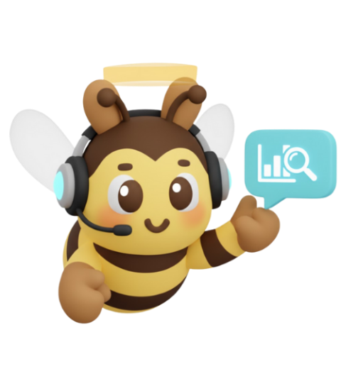

<h1 align="center">Rhussel Combo</h1>

  <b>Java &amp; Spring Boot Developer</b> 
  Computer Science at the University of Makati

  

  
  
  

   &nbsp;
   &nbsp;
   &nbsp;
   &nbsp;
  

### Projects

- **[BuzzSave](https://buzzsave.vercel.app/)** — AI expense tracker.
- **[S-Space Hub](https://rhusselcombo.is-a.dev/#sspace)** — Dormitel management.
- **[GroceReel](https://rhusselcombo.is-a.dev/#grocereel)** — Recipes and groceries.

### Recognition

- **AWS** — Certified Cloud Practitioner
- **UMak Infotechnolympics** — 1st Runner-Up (2026), 2nd Runner-Up (2025)
- **DICT Startup Challenge XI** — Top 15 NCR Regional Qualifier (2026)
