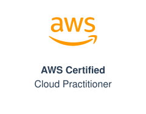
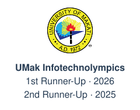
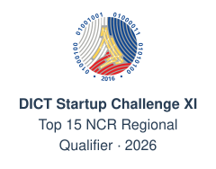
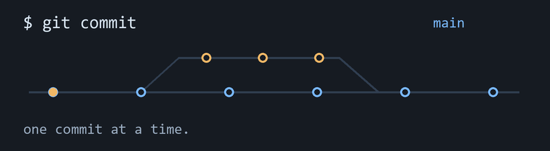

<h1 align="center">
  <picture>
    <source media="(max-width: 600px)" srcset="./assets/hello-mobile.svg">
    
  </picture>
</h1>

  <b>Java &amp; Spring Boot Developer</b> 
  Computer Science at the University of Makati

  
  
  

### About me

  <picture>
    <source media="(prefers-color-scheme: dark) and (max-width: 600px)" srcset="./assets/recognition/aws-mobile-dark.svg">
    <source media="(max-width: 600px)" srcset="./assets/recognition/aws-mobile.svg">
    <source media="(prefers-color-scheme: dark)" srcset="./assets/recognition/aws-dark.svg">
    
  </picture>
  <picture>
    <source media="(prefers-color-scheme: dark) and (max-width: 600px)" srcset="./assets/recognition/umak-mobile-dark.svg">
    <source media="(max-width: 600px)" srcset="./assets/recognition/umak-mobile.svg">
    <source media="(prefers-color-scheme: dark)" srcset="./assets/recognition/umak-dark.svg">
    
  </picture>
  <picture>
    <source media="(prefers-color-scheme: dark) and (max-width: 600px)" srcset="./assets/recognition/dict-mobile-dark.svg">
    <source media="(max-width: 600px)" srcset="./assets/recognition/dict-mobile.svg">
    <source media="(prefers-color-scheme: dark)" srcset="./assets/recognition/dict-dark.svg">
    
  </picture>

### Tech stack

   &nbsp;
   &nbsp;
  <picture><source media="(prefers-color-scheme: dark)" srcset="./assets/tech/mysql-dark.svg"></picture> &nbsp;
   &nbsp;
  

  <picture>
    <source media="(prefers-reduced-motion: reduce)" srcset="./assets/commit-loop-still.png">
    
  </picture>

### Projects

- **[BuzzSave](https://buzzsave.vercel.app/)** — AI expense tracker.
- **[S-Space Hub](https://rhusselcombo.is-a.dev/#sspace)** — Dormitel management.
- **[GroceReel](https://rhusselcombo.is-a.dev/#grocereel)** — Recipes and groceries.
