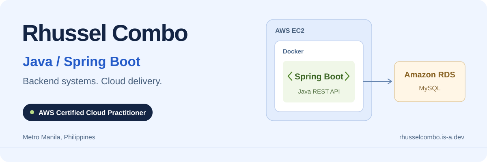

<picture>
  <source media="(prefers-color-scheme: dark)" srcset="assets/header-dark.svg">
  
</picture>

  <a href="https://rhusselcombo.is-a.dev/"><strong>Portfolio</strong></a> &nbsp; / &nbsp;
  <a href="https://www.linkedin.com/in/rhussel-jhone-combo-aa0a8a284/"><strong>LinkedIn</strong></a> &nbsp; / &nbsp;
  <a href="mailto:Rhusselbalajadia@gmail.com"><strong>Get in touch</strong></a>

I build **Java / Spring Boot backends** and take them through **Docker and cloud deployment**. My work includes finance APIs, a commercial dormitel platform, and the mobile experiences connected to them.

Based in **Metro Manila, Philippines**. Computer Science student at the **University of Makati**.

### What I work with

| Backend engineering | Cloud & delivery |
| :--- | :--- |
| Java 17 / 21 · Spring Boot | AWS EC2 · RDS · S3 |
| Spring Security · JWT · REST APIs | Azure Virtual Machines |
| JPA / Hibernate · MySQL | Docker · Multi-stage builds |
| Transactions · Idempotency · Data validation | Git · k6 load testing |

**AWS Certified Cloud Practitioner** · Issued February 2025 · Valid through February 2028

### Selected work

#### BuzzSave

**Personal finance platform · Thesis project**

Java 21 / Spring Boot APIs for expenses, budgets, and portfolios, backed by MySQL.

- Protected budget updates with **database transactions, idempotent requests, and stale-data validation**.
- Deployed the backend on **AWS EC2**, with **RDS** for MySQL and **S3** for files; packaged the service with a **multi-stage Docker build**.
- Hosted Python expense-classification models on **Azure VMs** and implemented on-device receipt OCR with offline expense queues and REST synchronization.

[Explore the project and engineering notes](https://rhusselcombo.is-a.dev/#buzzsave) · [Product website](https://buzzsave.vercel.app/)

#### S-Space Hub

**Dormitel management platform · Commercial client project**

Java 17 / Spring Boot backend with JWT authentication and MySQL for a commercial dormitel client.

- Deployed the backend on **AWS EC2**, with **Amazon RDS** and **S3**.
- Integrated **Gemini** for maintenance-ticket processing and used **k6** to load-test tenant and administrator API workflows.

[Explore the project and architecture](https://rhusselcombo.is-a.dev/#sspace)

#### GroceReel

**AI-assisted recipe and grocery discovery · Frontend prototype**

Built the **TypeScript / React Native** frontend with Expo Router, portion scaling, ingredient-swap cost calculations, pantry-aware shopping lists, and persistent local state.

[Explore the prototype](https://rhusselcombo.is-a.dev/#grocereel)

### Recognition

| Recognition | Project |
| :--- | :--- |
| 🥈 **1st Runner-Up, 2026** — UMak Infotechnolympics | BuzzSave |
| 🥉 **2nd Runner-Up, 2025** — UMak Infotechnolympics | BuzzSave |
| **Top 15 NCR Regional Qualifier, 2026** — DICT Philippine Startup Challenge XI | GroceReel |

GroceReel was selected from **108 startup entries**, representing the University of Makati.

### Experience

**Stefanini North America & APAC** · August 2024 – September 2025 
IT Support Specialist L1 → L2 / Subject Matter Expert

Worked with Active Directory, Microsoft Entra ID, Microsoft 365, DNS/TCP/IP troubleshooting, and support automation using Power Automate and API integrations with human review.

---

**Open to developer opportunities** with a focus on Java, Spring Boot, cloud, and DevOps work. [See the full portfolio](https://rhusselcombo.is-a.dev/) or [send me an email](mailto:Rhusselbalajadia@gmail.com).
